# taskflow-gitops — dépôt GitOps du cours CI/CD M2

Ce dépôt décrit **l'état voulu** de l'application TaskFlow dans Kubernetes.
Argo CD le surveille et aligne le cluster dessus : pour changer la production,
on ne tape pas de commande, on fait une **Pull Request**.

## Installation (à faire chez vous, avant le cours)

Prérequis : Docker Desktop démarré, 8 Go de RAM, 10 Go de disque libre.
Sous Windows : WSL2 (Ubuntu) + intégration WSL de Docker Desktop, et toutes les commandes dans WSL.

```bash
git clone https://github.com/9m7fjfpv9k-cyber/taskflow-gitops.git
cd taskflow-gitops
./scripts/install.sh
```

Le script crée un cluster local `kind`, installe Argo CD et Argo Rollouts,
puis télécharge les images des labs. Comptez 5 à 15 minutes.
Il peut être relancé sans risque.

## Structure

| Chemin | Rôle |
| --- | --- |
| `apps/taskflow/` | Les manifests surveillés par Argo CD |
| `argocd/application.yaml` | Déclare l'application dans Argo CD |
| `exemples/bluegreen/` | Manifests pour le déploiement Blue-Green |
| `exemples/canary/` | Manifests pour le déploiement Canary |
| `exemples/robustesse/` | Canary avec test de charge k6 automatique, modèle de postmortem |
| `exemples/ci/` | Pipelines de la mini-PSSI (GitHub Actions et GitLab CI) |
| `policies/` | Mini-PSSI et règles Rego vérifiées par conftest |
| `scripts/install.sh` | Installation de l'environnement |
| `scripts/argocd-ui.sh` | Ouvre l'interface d'Argo CD |
| `scripts/observe.sh` | Montre quelle version répond, et avec quel code HTTP |
| `scripts/charge.sh` | Lance à la main le test de charge k6 contre un service |

## Images disponibles

`ghcr.io/9m7fjfpv9k-cyber/taskflow` en versions `1.0.0`, `1.1.0`, `2.0.0`, `2.1.0` et `2.2.0`.

## Lab du matin — GitOps par PR, dérive et retour arrière

Cette première séance porte sur le flux GitOps : proposer les changements par
Pull Request, observer la réconciliation par Argo CD et revenir à l'état voulu
après une dérive.

### Captures complémentaires

Les captures ci-dessous complètent le compte rendu et documentent les changements de synchronisation et les événements du pod `taskflow`.


La synchronisation a bien été validée par Argo CD : la phase est `Succeeded`, la révision est indiquée et la ressource est redevenue `Synced`/`Healthy`.


Cette capture montre les événements du pod après la mise à jour : création du conteneur, démarrage puis vérification de l'état du pod. Elle confirme que Kubernetes a bien tiré et démarré l'image demandée.


Cette vue met en évidence le point de contrôle de disponibilité (`readiness probe`) : le pod a d'abord été jugé non sain avant d'être complètement prêt à servir les requêtes, ce qui est normal lors d'un redémarrage ou d'une mise à jour.

### Compte rendu — déployer par PR, provoquer une dérive, revenir en arrière

Le lab illustre un flux GitOps : Git contient l'état souhaité, et Argo CD le
réconcilie avec Kubernetes. Les captures ci-dessous sont les éléments de preuve
disponibles dans le dépôt. Elles montrent la configuration de branche, l'état
de l'application et l'observation de la version initiale ; elles ne documentent
pas à elles seules les PR de mise à jour, de revert ou de suppression.

#### 1. Fork, binôme et règles de branche

Forkez le dépôt, invitez votre binôme parmi les collaborateurs, puis configurez
un ruleset ciblant `main` dans **Settings > Rules > Rulesets**. Le ruleset doit
protéger les changements apportés à cette branche, notamment en demandant une
Pull Request plutôt qu'un push direct.

La capture confirme qu'un ruleset `main-rules` cible une branche. Elle ne montre
pas les options sélectionnées ni l'invitation du binôme.


#### 2. Déclarer le dépôt dans Argo CD

Vérifiez que `repoURL` dans [`argocd/application.yaml`](argocd/application.yaml)
pointe vers le fork utilisé par votre binôme. Dans ce dépôt, l'URL est déjà
`https://github.com/Ayoub-ELHanda/taskflow-gitops.git`. Sur chaque cluster,
vérifiez le contexte puis créez ou mettez à jour l'Application :

```bash
kubectl config current-context
# Le contexte attendu est kind-cicd.
kubectl apply -f argocd/application.yaml
```

L'Application suit `main` et le répertoire `apps/taskflow`. La synchronisation
automatique y est activée.

#### 3. Vérifier l'état initial et la version servie

Dans Argo CD, l'application `taskflow` doit afficher **Healthy** et **Synced**.
Lancez ensuite le script d'observation :

```bash
./scripts/observe.sh
```

Il envoie 40 requêtes au Service et regroupe les réponses par version et code
HTTP. La capture fournie montre 40 réponses `version=1.0.0 http=200`, ce qui
confirme l'état initial observé.


#### 4. Déployer la version 2.0.0 par Pull Request

Dans une branche de travail, modifiez l'image du Deployment dans
[`apps/taskflow/deployment.yaml`](apps/taskflow/deployment.yaml), de `1.0.0` à
`2.0.0`. Poussez cette branche, ouvrez une PR vers `main`, faites-la relire,
puis fusionnez-la. Argo CD détecte la nouvelle révision et applique le manifeste.
Vérifiez que l'application redevient **Healthy** et **Synced**, puis lancez
`./scripts/observe.sh` pour confirmer que les réponses indiquent `2.0.0`.

Pour mesurer le délai, notez l'heure de fusion de la PR et l'heure à laquelle
Argo CD indique **Synced** et l'observation renvoie la nouvelle version. Le
délai correspond à la différence entre ces deux instants. Aucune capture fournie
ne montre cette PR ni ses horodatages : le délai réel reste donc à renseigner
dans le journal de déploiement.

#### 5. Provoquer une dérive et observer l'auto-réconciliation

Après le déploiement de la PR, modifiez temporairement le cluster directement :

```bash
kubectl scale deployment/taskflow --replicas=1 -n taskflow
kubectl set image deployment/taskflow \
  taskflow=ghcr.io/9m7fjfpv9k-cyber/taskflow:1.0.0 -n taskflow
```

Ces commandes créent une dérive par rapport à Git : le nombre de réplicas et
l'image ne correspondent plus à `apps/taskflow/deployment.yaml`. Comme
`selfHeal: true` est configuré dans l'Application, Argo CD détecte l'écart et
réapplique l'état déclaré dans Git (image `2.0.0` et quatre réplicas). La
correction est automatique ; les commandes `kubectl` ne modifient pas la source
de vérité. Vérifiez le retour à **Synced**, puis les pods et les réponses du
Service.

#### 6. Revenir à la version 1.0.0 avec Revert

Utilisez **Revert** sur la PR fusionnée de mise à jour dans GitHub. GitHub crée
une nouvelle PR qui annule le changement ; après revue et fusion, le manifeste
dans `main` déclare à nouveau l'image `1.0.0`. Argo CD applique cette révision,
puis `./scripts/observe.sh` permet de vérifier le retour de la version servie à
`1.0.0`.

Un revert Git conserve l'historique : il ajoute un changement inverse au lieu
de réécrire ou supprimer la PR précédente. Cela rend le retour en arrière
traçable et laisse Argo CD réconcilier le cluster à partir de Git.

#### 7. Bonus — supprimer le Service par PR

Supprimez `apps/taskflow/service.yaml` dans une branche, puis ouvrez et fusionnez
une PR vers `main`. Avec `prune: true`, Argo CD supprime du cluster la ressource
Service qui n'est plus déclarée dans le dépôt. Les pods du Deployment peuvent
rester en fonctionnement, mais le Service `taskflow` n'existe plus et les
requêtes via ce point d'accès échouent. Vérifiez la suppression dans l'arbre
des ressources Argo CD ou avec :

```bash
kubectl -n taskflow get service taskflow
```

La commande doit alors signaler que le Service est introuvable. Cette étape est
destructive pour l'accès à l'application : ne la faites que dans le cluster de
lab.

### Journal et réponses à remettre

Complétez les informations qui ne figurent pas dans les captures avant de
remettre le compte rendu :

| Étape | Révision ou action | Résultat à consigner |
| --- | --- | --- |
| État initial | Image `1.0.0` | 40 réponses HTTP 200 observées |
| Mise à jour | PR vers l'image `2.0.0` | Lien/numéro de PR, heure de fusion, heure de disponibilité, délai mesuré |
| Dérive | `scale` puis `set image` | Temps de retour à l'état Git et version observée |
| Retour arrière | PR Revert | Lien/numéro de PR et confirmation de `1.0.0` |
| Bonus | Suppression de `service.yaml` | Lien/numéro de PR et confirmation du prune |

**Push ou pull ?** Le changement de configuration est poussé dans Git par le
développeur, au moyen d'une branche et d'une PR. Pour le déploiement, Argo CD
utilise un modèle *pull* : il surveille le dépôt, récupère l'état désiré et le
réconcilie avec le cluster. Un push direct sur Kubernetes n'est pas le mécanisme
de déploiement attendu.

**Qui a corrigé quoi ?** À consigner avec les vrais noms et liens des PR : la
personne qui a proposé la modification change le manifeste ; le binôme la relit
et l'approuve selon les règles de `main` ; après fusion, Argo CD applique la
révision. Pour une dérive manuelle, Argo CD restaure lui-même la configuration
Git grâce à `selfHeal`. Les captures disponibles ne permettent pas d'attribuer
ces actions à des personnes précises.

**Pourquoi utiliser Git Revert ?** Le revert fournit une correction revue et
auditée dans l'historique Git. Il restaure la configuration voulue sans masquer
la modification initiale ; Argo CD voit le nouvel état de `main` et ramène le
cluster à cet état.

## Lab de l'après-midi — Blue-Green puis Canary

En binôme (2 h 15), faire évoluer TaskFlow de `1.0.0` vers `1.1.0` avec
Blue-Green, puis tester Canary jusqu'à `2.0.0`. Le dernier essai vers `2.1.0`
sert à observer les erreurs HTTP et à décider quand interrompre le rollout.
Les captures ci-dessous sont celles de cette séance ; elles montrent des étapes
réalisées, mais ne remplacent pas les PR ni le journal à compléter.

### A. Blue-Green — déployer `1.1.0`

Dans une branche, remplacer le Deployment par le manifeste Blue-Green de
`exemples/bluegreen/`, puis ouvrir une PR. Après revue et fusion, l'image
`1.1.0` passe dans l'environnement. Comparer le service actif `taskflow` avec
`taskflow-preview`, compter les pods, puis promouvoir la preview :

```bash
kubectl argo rollouts get rollout taskflow -n taskflow
./scripts/observe.sh taskflow-preview
./scripts/observe.sh taskflow
kubectl argo rollouts promote taskflow -n taskflow
./scripts/observe.sh
```

Le premier contrôle confirme la version de l'outil Argo Rollouts installé.


Ces deux captures montrent le même état Git avant la PR. La seconde est une
copie identique conservée parmi les fichiers ajoutés.


Le diff remplace l'image `1.0.0` par `1.1.0` dans le manifeste de rollout.


La PR #23 pour `1.1.0` est encore ouverte dans cette capture : elle prouve la
proposition du changement, pas sa fusion.


Cette capture montre la PR initiale qui active Argo Rollouts en Blue-Green
(`1.0.0`) fusionnée dans `main`.


Le commit suivant déclare `1.1.0` dans le rollout Blue-Green.


Le rollout est en pause avec `1.0.0` comme version active et `1.1.0` en
preview ; les deux groupes de pods permettent de comparer avant promotion.


L'observation confirme la séparation : les requêtes vers `taskflow-preview`
retournent `1.1.0`, tandis que le service actif `taskflow` répond encore en
`1.0.0`. Après promotion, refaire l'observation sur le service actif.


### B. Canary — progresser jusqu'à `2.0.0`, puis interrompre `2.1.0`

Remplacer le manifeste actif par `exemples/canary/rollout.yaml` et déclarer
`1.1.0` dans une PR. Ensuite, proposer `2.0.0` par une nouvelle PR. Suivre les
étapes du rollout et observer à la fois le statut et les réponses HTTP :

```bash
kubectl argo rollouts get rollout taskflow -n taskflow --watch
./scripts/observe.sh
```

Quand les vérifications sont satisfaisantes, promouvoir jusqu'à 100 % :

```bash
kubectl argo rollouts promote taskflow -n taskflow
kubectl argo rollouts get rollout taskflow -n taskflow
./scripts/observe.sh
```

Le rollout Canary `1.1.0` est alors sain et sert de point de départ stable.


Le changement de stratégie remplace Blue-Green par les étapes progressives
Canary, avec des paliers de poids et des pauses.


Cette capture confirme l'état Canary avant le déploiement de la version
suivante : `1.1.0` est stable et les quatre réplicas sont disponibles.


Le manifeste Canary définit les étapes de progression du trafic et leurs pauses.


Les résultats d'observation évoluent de `30/10` à `26/14` réponses entre les
versions `1.1.0` et `2.0.0` : ils illustrent le déplacement progressif du
trafic. Ce sont des échantillons de requêtes, pas une mesure exacte du poids
configuré.


Après promotion, l'état indique `2.0.0` stable à 100 % et le rollout est sain.


Pour l'essai suivant, une branche propose `2.1.0`. La capture d'observation
montre des réponses `HTTP 500` en plus des réponses `HTTP 200` : ne pas
promouvoir davantage et interrompre le rollout pour préserver la version stable.


Interrompre la progression avec :

```bash
kubectl argo rollouts abort taskflow -n taskflow
./scripts/observe.sh
kubectl argo rollouts get rollout taskflow -n taskflow
```

Après l'abort, les 40 requêtes observées répondent à nouveau en `2.0.0`.
La capture affiche toutefois le rollout en état `Degraded` avec
`RolloutAborted` : l'application sert la version stable, mais le statut du
rollout n'est pas déclaré sain par cet abort.


### Livrable de l'après-midi

Compléter le journal avec les PR, les versions, les observations et la décision
d'interruption. Argumenter le choix de Blue-Green ou Canary pour TaskFlow en
fonction du risque accepté et du coût (ressources et complexité opérationnelle).

| Étape | Résultat à consigner |
| --- | --- |
| Blue-Green `1.1.0` | PR, comparaison `taskflow` / `taskflow-preview`, nombre de pods, résultat après promotion |
| Canary `2.0.0` | PR, progression observée, confirmation de la promotion à 100 % |
| Canary `2.1.0` | PR, codes HTTP, décision et moment de l'abort, version servie après interruption |
| Choix de stratégie | Blue-Green ou Canary pour TaskFlow, justifié par le risque et le coût |

J3- Lab du main
2.0.0 → 2.1.0 → abort automatique → 2.2.0

1/revert the vertion from  2.1.0. -> 2.0.0
./scripts/observe.sh
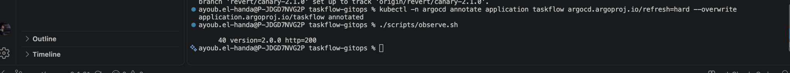

2/ 2///
A.
Le script termine par Résultat : seuils respectés.

Pour comprendre ces valeurs :

0 erreur sur 735 requêtes : toutes les requêtes ont reçu un 200, ce que confirme ✓ statut 200 et checks_failed: 0.00%.
p95 = 5,77 ms : 95 % des réponses sont arrivées en moins de 5,77 millisecondes, soit environ 40 fois sous le seuil de 250 ms. Les autres valeurs vont dans le même sens : moyenne 3,64 ms, médiane 3,56 ms, maximum 7,64 ms.
735 requêtes en 30 s, soit environ 24 requêtes par seconde, avec 5 utilisateurs virtuels. C'est une charge légère, qui ne met pas l'application en difficulté.

resulta final :

./scripts/charge.sh http://taskflow/ sur la version stable 2.0.0 : erreurs = 0,00 % (0/735), p95 = 5,77 ms. Seuils respectés (erreurs < 2 %, p95 < 250 ms).

3- la PR et la synchronisation
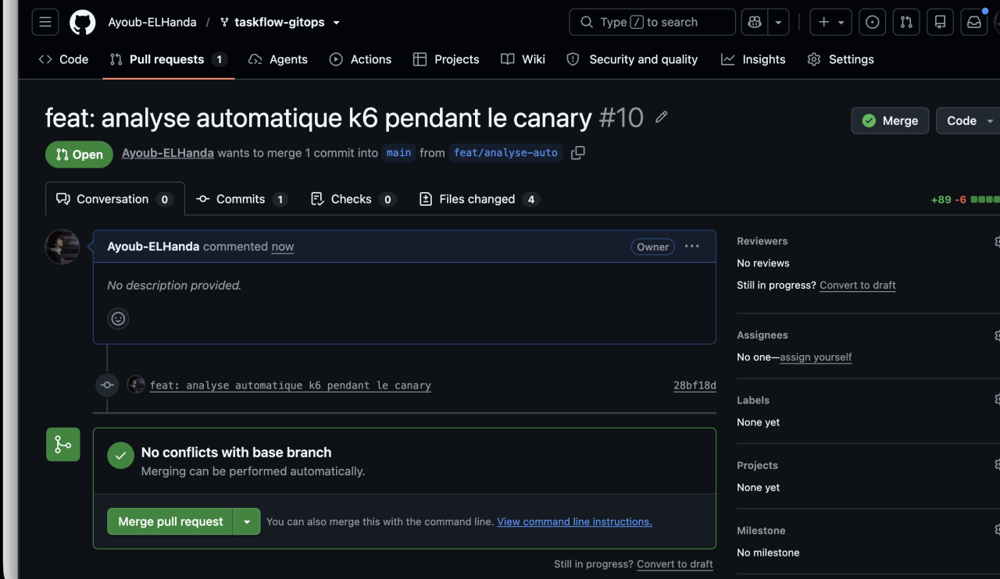
Status: ✔ Healthy, Strategy: Canary, Step: 7/7 et l'image 2.0.0 (stable), comme à ma dernière vérification.
(captures/get-rollout.png)

4/ Tout est vérifié et conforme :

Git : apps/taskflow contient un Rollout, un AnalysisTemplate, une ConfigMap et deux services, et aucun Deployment.
Cluster : les 8 CRD Argo sont installées, et le namespace taskflow contient robustesse-k6, k6-robustesse, taskflow et taskflow-canary.
Conclusion : ce qui est décrit dans Git est exactement ce qui tourne dans le cluster.
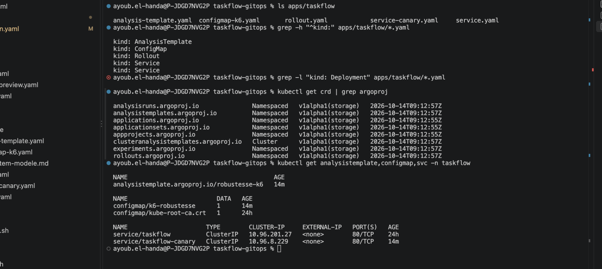

B.
1- kubectl argo rollouts get rollout taskflow -n taskflow --watch
Ce qui s'est passé, dans l'ordre
Votre PR a changé l'image en 2.1.0, et Argo CD l'a appliquée.
Argo Rollouts a démarré 1 pod 2.1.0 (25 %), puis a attendu 20 s.
Il a lancé le test k6 sur taskflow-canary, qui ne vise que ce pod.
Les seuils ont été dépassés, le Job a échoué, et Argo Rollouts a abandonné le déploiement sans votre intervention.
Les utilisateurs n'ont été exposés qu'au canary, pendant environ une minute. Hier, c'est vous qui aviez repéré les 500 et tapé abort.
Git dit toujours 2.1.0, comme hier : le Rollout reste Degraded tant qu'une PR ne remet pas 2.0.0.
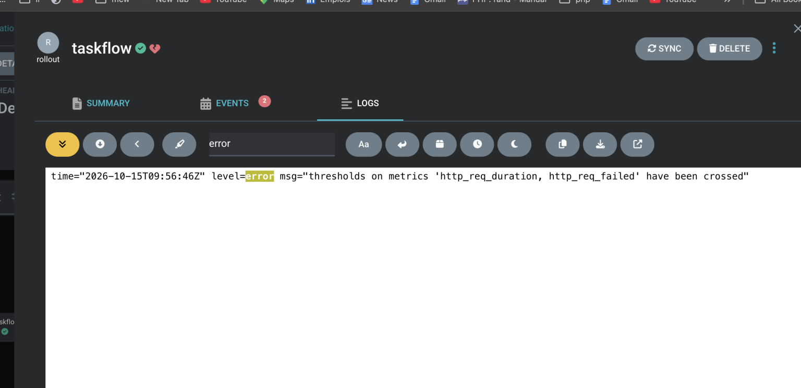

2-
Preuve 1 :
kubectl argo rollouts get rollout taskflow -n taskflow

la révision est : Deux remarques :

Cette sortie ne dit pas quelle image portait la révision 6. Elle n'affiche que la stable (2.0.0). C'est pourquoi je vous ai donné la commande kubectl get rs taskflow-df976ccb5 ... : sa réponse prouve que l'image fautive est la 2.1.0. Faites-la pour compléter la preuve 1.
Les restarts:2 sur trois pods viennent de l'arrêt du cluster hier, sans rapport avec l'incident. Le pod taskflow-c6cf57bd6-tlvs9 (11 min) est celui qui a été relancé pour remettre 4 pods stables après l'abandon.
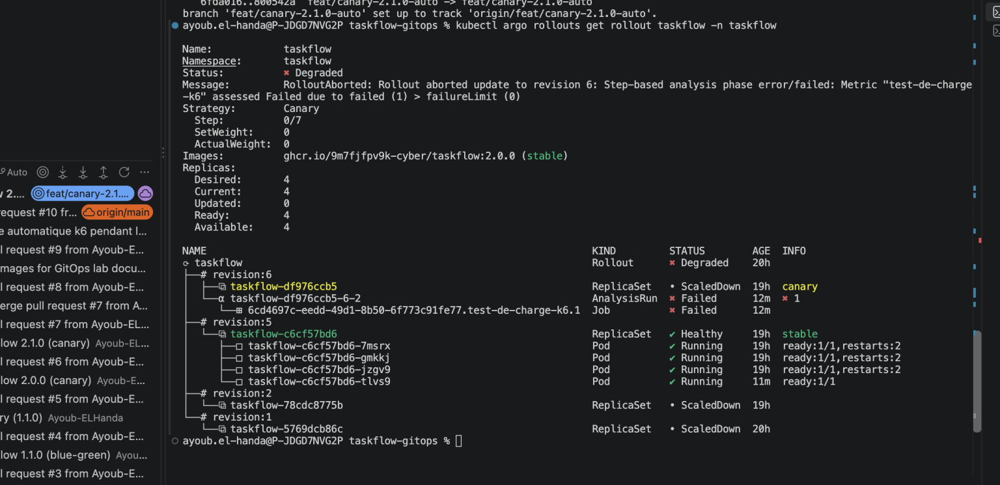
pour voir la version voisi la commande qui complète la preuve 1

ayoub.el-handa@P-JDGD7NVG2P taskflow-gitops % kubectl get rs taskflow-df976ccb5 -n taskflow -o jsonpath='{.spec.template.spec.containers[0].image}{"\n"}'

ghcr.io/9m7fjfpv9k-cyber/taskflow:2.1.0
ayoub.el-handa@P-JDGD7NVG2P taskflow-gitops %

Preuve 2 :
Le nom taskflow-df976ccb5-6-2 veut dire : le Rollout taskflow, la nouvelle version df976ccb5, la révision 6, l'étape 2.
step-index=2 désigne la 3ᵉ étape du Rollout en comptant depuis 0 : l'étape 0 est setWeight: 25, l'étape 1 la pause de 20 s, l'étape 2 l'analyse.
Elle appartient au Rollout, qui l'a lancée lui-même.
Ce qui devait être exécuté (Spec)

La cible est http://taskflow-canary/ : seulement les pods de la nouvelle version, jamais la production.
La mesure est un Job Kubernetes qui lance k6 avec le script de votre ConfigMap k6-robustesse.
Backoff Limit: 0 : pas de deuxième essai si le Job échoue.
{{args.cible}} reste écrit tel quel dans la sortie : c'est la forme modèle, remplacée à l'exécution par la valeur de Args.
Le résultat (Status)

Phase: Failed : l'analyse est en échec.
Le message dit assessed Failed due to failed (1) > failureLimit (0) : un échec constaté alors que zéro était toléré. C'est ce qui a déclenché l'abandon.
Début à 09:56:15Z et fin à 09:56:52Z : 37 secondes.
Count 1, Failed 1 : une seule mesure a été faite, et elle a échoué.
Le nom du Job k6 est 6cd4697c-...test-de-charge-k6.1. On s'en sert pour la preuve 3.
Les événements (Events)

MetricFailed, puis AnalysisRunFailed : d'abord la métrique est jugée en échec, puis l'analyse entière.

Ce qui a échoué : la métrique test-de-charge-k6, sur la révision 6.
Cette preuve ne dit pas pourquoi : erreurs ou lenteur, c'est dans les logs du Job, donc la preuve 3.
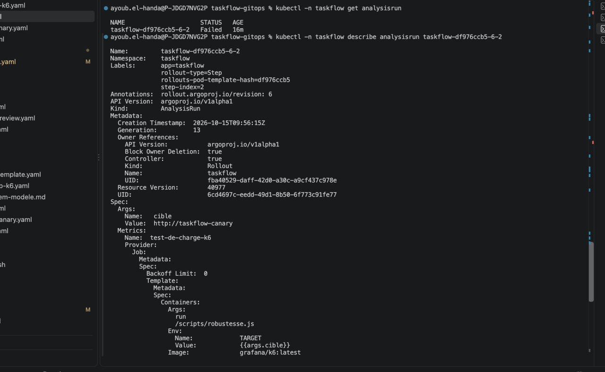

Preuve 3 :
Voici la preuve 3 expliquée, sans tableau. C'est le même test que votre charge.sh, avec les mêmes réglages, donc les chiffres sont directement comparables.

Le test

script: /scripts/robustesse.js, 5 utilisateurs virtuels pendant 30 secondes : c'est le script de la ConfigMap k6-robustesse.
Les lignes running (0m01.0s) ... ne sont que la barre de progression. Vous pouvez les ignorer.
Le verdict : bloc THRESHOLDS

✗ 'p(95)<250' p(95)=310.32ms : le p95 est de 310 ms, pour un seuil de 250 ms.
✗ 'rate<0.02' rate=27.33% : 27,33 % de requêtes en échec, pour un seuil de 2 %.
Les deux seuils sont dépassés, ce qui est plus grave qu'un seul.
Les résultats : TOTAL RESULTS

checks_total: 300 : 300 requêtes au total.
218 out of 300 ont reçu un 200, et 82 ont échoué, soit 27,33 %.
http_req_failed: 27.33% 82 out of 300 donne la même information.
La latence : http_req_duration

Moyenne 305 ms, minimum 300,74 ms, médiane 304,94 ms, maximum 316,57 ms.
Toutes les valeurs sont regroupées autour de 300 ms. On dirait un délai fixe d'environ 300 ms sur chaque requête : c'est une déduction à partir des chiffres, pas une cause lue dans le code.
La ligne { expected_response:true } ne concerne que les réponses réussies : elles prennent aussi environ 306 ms. La lenteur touche donc les réponses réussies comme les autres, pas seulement celles en erreur.
Le débit : http_reqs et iteration_duration
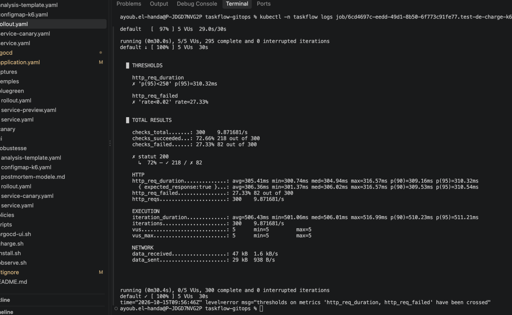
300 requêtes en 30 s, soit environ 9,9 par seconde.
Chaque itération dure en moyenne 506 ms : environ 300 ms de requête plus 200 ms de pause dans le script. Cela confirme la lenteur.
La dernière ligne

time="2026-10-15T09:56:46Z" level=error msg="thresholds on metrics 'http_req_duration, http_req_failed' have been crossed" indique que k6 a terminé en erreur parce que les seuils ont été dépassés, à 09:56:46Z.
Le Job est alors devenu Failed, et l'AnalysisRun s'est terminé en échec à 09:56:52Z, quelques secondes plus tard. La chaîne cause-effet est complète.
Comparaison avec votre référence de la 2.0.0

Erreurs : 0,00 % contre 27,33 %.
p95 : 5,77 ms contre 310,32 ms.
Requêtes en 30 s : 735 contre 300, parce que chaque requête prenait 300 ms au lieu de 4 ms.
À noter pour le postmortem

Les deux seuils dépassés : p95 = 310,32 ms et erreurs = 27,33 % (82 sur 300).
Une latence d'environ 300 ms sur chaque requête.
Le test se termine à 09:56:46Z, et l'analyse est déclarée en échec à 09:56:52Z.
Cette preuve montre ce qui est cassé, pas la cause dans le code de la 2.1.0 : elle n'est pas visible ici.

Preuve 4 :
La chronologie de l'incident
09:55:50Z, le déploiement démarre. RolloutUpdated, SuccessfulCreate du ReplicaSet taskflow-df976ccb5, et le pod taskflow-df976ccb5-n689l est créé et démarré. Un pod stable est retiré (Killing taskflow-c6cf57bd6-ft4wv) pour laisser sa place : 3 pods stables et 1 canary. Le Unhealthy à cette heure correspond très probablement à la sonde de démarrage du nouveau pod, un bruit normal ; je n'ai pas lu son message complet.
09:55:55Z, palier à 25 %. SwitchService : le service taskflow-canary est basculé vers le nouveau pod. RolloutStepCompleted (étape 1) puis RolloutPaused.
09:56:15Z, début du test. RolloutResumed et RolloutStepCompleted (la pause de 20 s est écoulée, 20 s après 09:55:55 : c'est cohérent). AnalysisRunRunning : l'analyse démarre. Le Job k6 est créé, et son pod est créé, tiré et démarré.
09:56:48Z, le test échoue. BackoffLimitExceeded sur le Job : k6 a terminé en erreur (le log disait 09:56:46Z) et n'a droit à aucun nouvel essai.
09:56:52Z, la réaction. C'est un bloc d'événements simultanés :
MetricFailed, puis AnalysisRunFailed (sur l'AnalysisRun et sur le Rollout) ;
RolloutAborted ;
SwitchService : le service canary revient vers les pods stables ;
Killing et SuccessfulDelete du pod n689l (la 2.1.0 est supprimée) ;
SuccessfulCreate du pod stable taskflow-c6cf57bd6-tlvs9, qui remet les pods stables à 4, avec ses Created, Started et un Unhealthy de démarrage.
Ce qu'on en tire
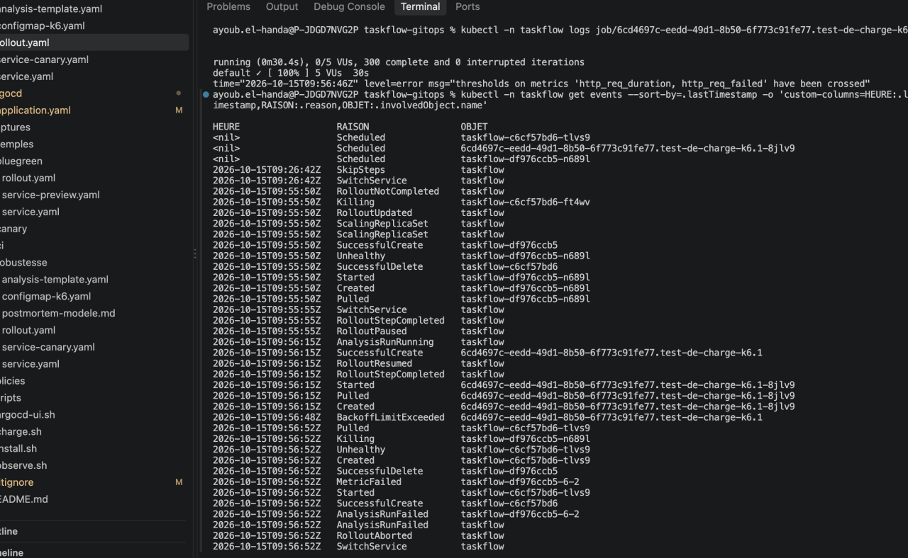
Délai de détection et de réaction : environ 62 secondes entre le début du déploiement (09:55:50Z) et l'abandon (09:56:52Z), sans qu'un humain intervienne.
Exposition des utilisateurs : environ 1 minute, de la bascule du service canary (09:55:55Z) à son retour (09:56:52Z). D'après le README du dépôt, la part de trafic suit la proportion de pods : environ 25 %, soit 1 pod sur 4. C'est une estimation.
Détecté par : le test de charge k6, et non une sonde Kubernetes : la sonde de santé n'a rien signalé de grave.
Résolu par : l'abandon automatique. Git dit toujours 2.1.0,
kubectl get rs taskflow-df976ccb5 -n taskflow -o 

revert
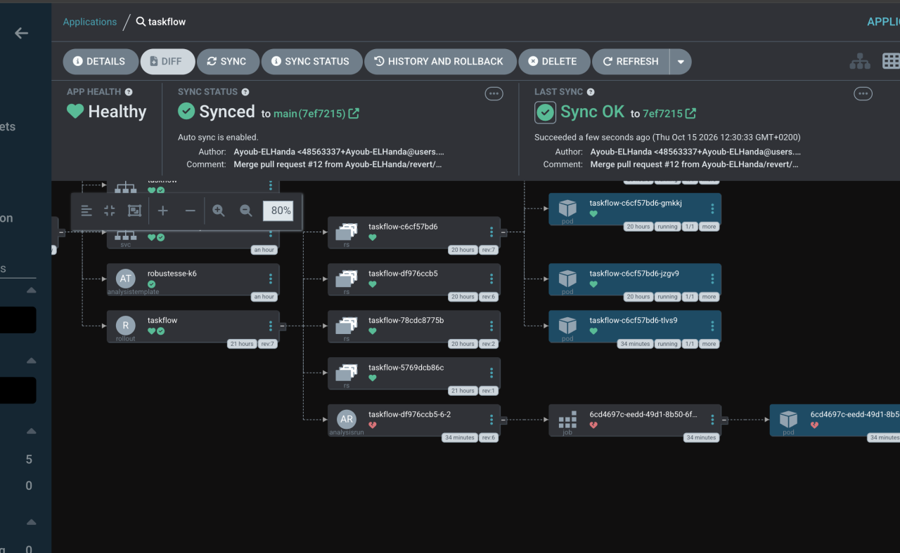
annulé la PR #11 (l'image 2.1.0) avec git revert -m 1 f3f70e4. Cela a créé le commit c981645 sur la branche revert/canary-2.1.0-auto.
Le diff était d'une seule ligne : 2.1.0 remplacé par 2.0.0.
Après le merge de cette PR, le Rollout est passé de Degraded à Healthy, avec la révision 7 stable en 2.0.0. Cela montre qu'Argo CD a bien repris la correction de Git. Je n'ai pas vu le numéro de cette PR de revert, il est à lire sur GitHub.

4- 
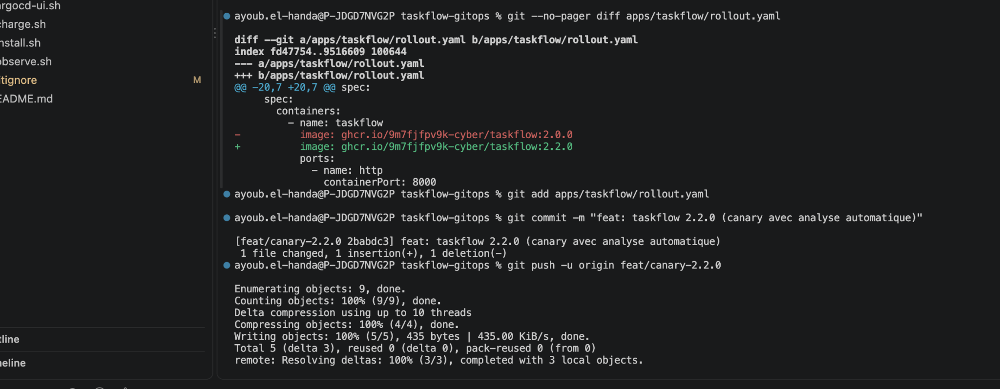
Le diff est correct : une seule ligne, 2.0.0 remplacé par 2.2.0. Le suivi que vous avez collé montre l'état d'avant : Healthy, 2.0.0 (stable), Step 7/7, sans rien de nouveau. Rien n'est donc encore parti, c'est normal : il reste à commiter, pousser et fusionner.

Remarque : le --watch réécrit tout l'écran à chaque rafraîchissement, donc un copier-coller répète le même bloc plusieurs fois. Pour me montrer l'état, collez seulement la dernière image, la plus basse.
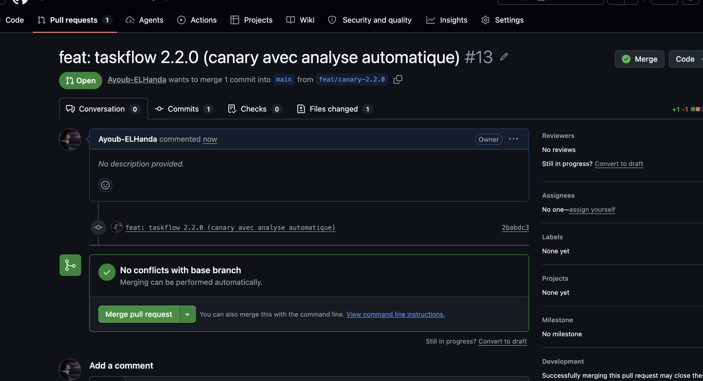
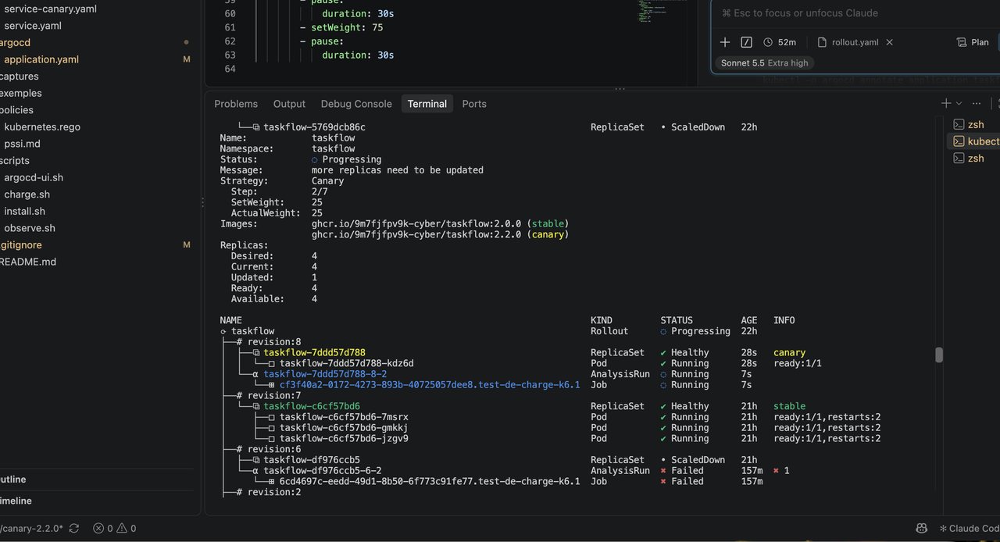
application.argoproj.io/taskflow annotated
ayoub.el-handa@P-JDGD7NVG2P taskflow-gitops % ./scripts/observe.sh

     40 version=2.2.0 http=200
ayoub.el-handa@P-JDGD7NVG2P taskflow-gitops %
5-
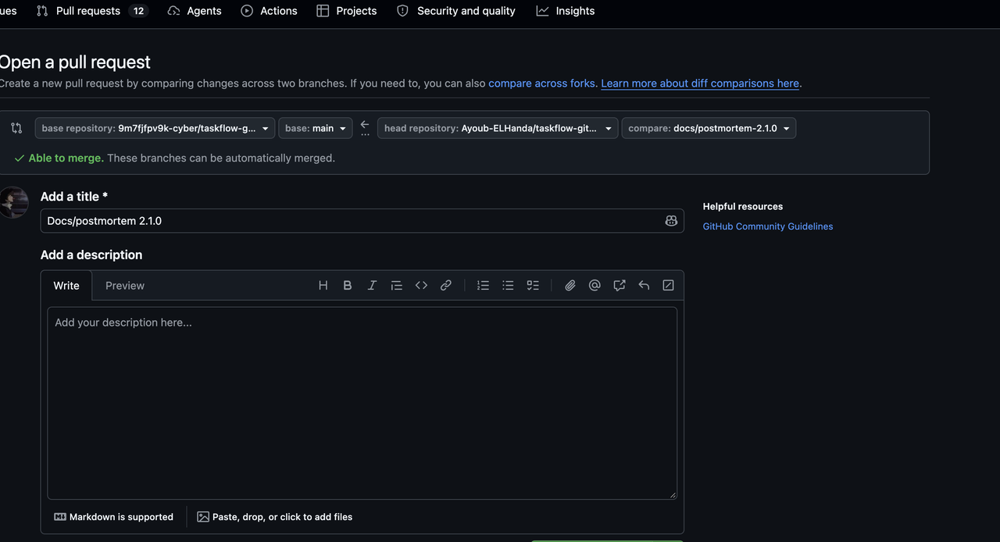
le fichier docs/postmortem-2.1.0.md est créé (67 lignes). Je n'ai fait ni git add, ni commit, ni push, ni PR.

git status confirme que seul docs/ s'est ajouté, en plus de vos deux modifications d'avant (.gitignore et application.yaml). J'ai aussi vérifié que les chiffres clés y sont : p95 de 310,32 ms, 27,33 %, les PR #10 à #13 et l'AnalysisRun taskflow-df976ccb5-6-2.

Lab C
1- La lecture de pssi.md est de p kubernetes.rgo 

La mini-PSSI est un ensemble de 5 règles de sécurité, vérifiées automatiquement sur chaque PR (« quality gates ») : une règle non respectée bloque le merge.

R1 : toute image a un tag explicite, jamais latest.
R2 : les images viennent uniquement de ghcr.io/9m7fjfpv9k-cyber/.
R3 : chaque conteneur a une limite de mémoire. À écrire.
R4 : les pods ne tournent pas en root (runAsNonRoot: true). À écrire.
R5 : aucune vulnérabilité HIGH ou CRITICAL corrigeable dans les images. Vérifiée par Trivy.
R1 à R4 sont contrôlées par conftest (règles Rego dans kubernetes.rego), R5 par Trivy.
install conflest 
ayoub.el-handa@P-JDGD7NVG2P taskflow-gitops % conftest --version

Conftest: 0.71.1
OPA: 1.21.1
ayoub.el-handa@P-JDGD7NVG2P taskflow-gitops %
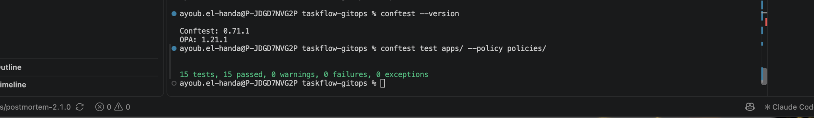

2-
Ecriture du R3 et R4
PSSI-R3 : chaque conteneur doit avoir une limite de mémoire.
deny contains msg if {
    some c in conteneurs
    not c.resources.limits.memory
    msg := sprintf("PSSI-R3 : le conteneur '%s' n'a pas de limite de mémoire (resources.limits.memory)", [c.name])
}

PSSI-R4 : le pod doit déclarer runAsNonRoot: true.
pod_non_root if {
    input.spec.template.spec.securityContext.runAsNonRoot == true
}

deny contains msg if {
    charges_de_travail[input.kind]
    not pod_non_root
    msg := sprintf("PSSI-R4 : le pod de '%s' ne déclare pas runAsNonRoot: true", [input.metadata.name])
}
!{captures/C2.png}(captures/C2.png)
La règle R4 fonctionne : elle détecte le manque, et 25 tests, 24 passed, 1 failure est le résultat voulu. R3, elle, passe, puisque votre Rollout a bien

3- 
Nous avons ajouté sur le fichier rollout.yaml 
spec:
      securityContext:
        runAsNonRoot: true
      containers:
    name: taskflow

Pour ajouter runAsNonRoot au pod
youb.el-handa@P-JDGD7NVG2P taskflow-gitops % conftest test apps/ --policy policies/


25 tests, 25 passed, 0 warnings, 0 failures, 0 exceptions
ayoub.el-handa@P-JDGD7NVG2P taskflow-gitops %
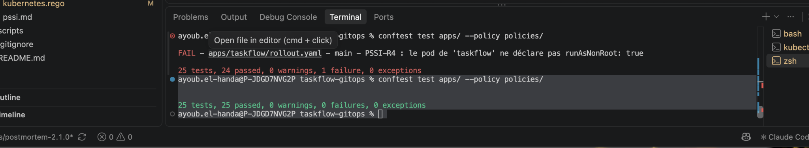
Cette modification change le modèle de pod, donc le Rollout lancera un nouveau déploiement canary,
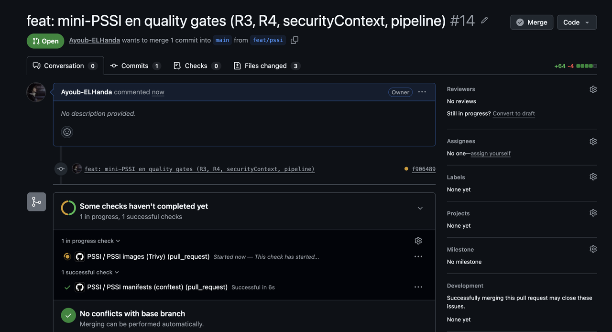
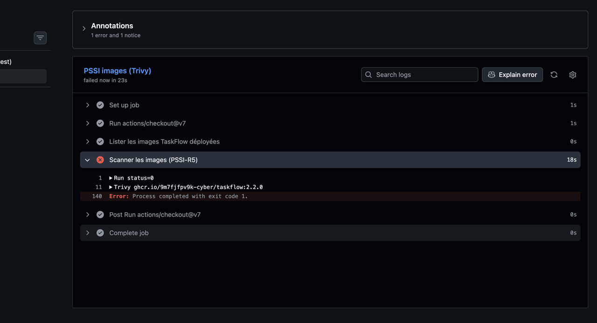
Le contrôle PSSI images (Trivy) est rouge, et la capture dit pourquoi :

L'étape Scanner les images (PSSI-R5) a échoué, en 18 secondes.
Trivy a scanné ghcr.io/9m7fjfpv9k-cyber/taskflow:2.2.0, puis le job s'est terminé avec exit code 1.
Dans le pipeline, Trivy est lancé avec --severity HIGH,CRITICAL --ignore-unfixed --exit-code 1. Un code de sortie 1 signifie donc qu'il a trouvé au moins une vulnérabilité HIGH ou CRITICAL pour laquelle un correctif existe dans cette image. La règle R5 est donc violée.

les vulnérabilités sont dans l'image 2.2.0 elle-même, qui existait déjà.

Le détail est dans les lignes repliées de la capture.
Ce qui est propre. Le système de l'image (Debian 13.7) a 0 vulnérabilité.

Ce qui est rouge. Il y a 9 vulnérabilités, toutes HIGH, aucune CRITICAL, toutes avec un correctif disponible (Status: fixed), dans deux bibliothèques Python :

starlette 0.41.3 : CVE-2025-62727 (corrigée en 0.49.1), CVE-2026-48818 (corrigée en 1.1.0) et CVE-2026-54283 (corrigée en 1.3.1).
urllib3 1.26.20 : CVE-2025-66418 et CVE-2025-66471 (corrigées en 2.6.0), CVE-2026-21441 (2.6.3), CVE-2026-44431 (2.7.0), CVE-2026-97687 et CVE-2026-97689 (2.8.0).
Comme ces correctifs existent, la règle R5 les compte, d'où le exit code 1.

4- 
Créer le fichier .trivyignore
Exceptions PSSI-R5 — image ghcr.io/9m7fjfpv9k-cyber/taskflow:2.2.0
Ajoutées le 2026-10-15. Correctif disponible, mais il exige de reconstruire
l'image (hors du périmètre de ce dépôt GitOps). Exploitabilité dans TaskFlow
non vérifiée : le code applicatif n'est pas dans ce dépôt.
Exception temporaire : à lever avant l'échéance, en demandant une image
reconstruite avec starlette >= 1.3.1 et urllib3 >= 2.8.0.
starlette 0.41.3
CVE-2025-62727 exp:2026-10-30
CVE-2026-48818 exp:2026-10-30
CVE-2026-54283 exp:2026-10-30

urllib3 1.26.20
CVE-2025-66418 exp:2026-10-30
CVE-2025-66471 exp:2026-10-30
CVE-2026-21441 exp:2026-10-30
CVE-2026-44431 exp:2026-10-30
CVE-2026-97687 exp:2026-10-30
CVE-2026-97689 exp:2026-10-30
securityContext
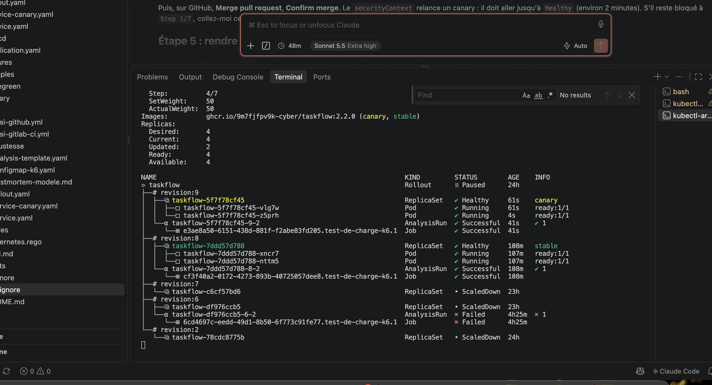
5- 

Ruleset : rendre obligatoires « PSSI manifests (conftest) » et « PSSI images (Trivy) »
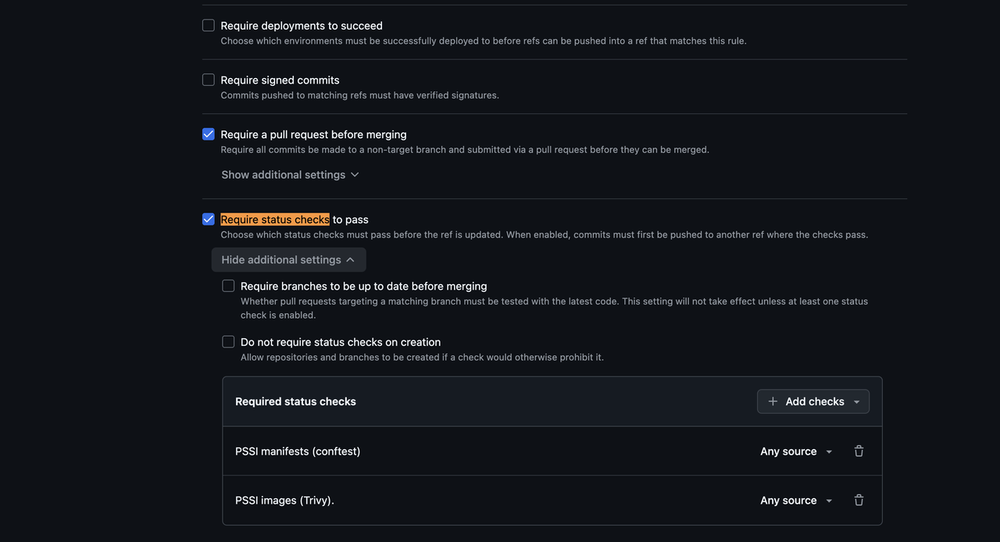
6-
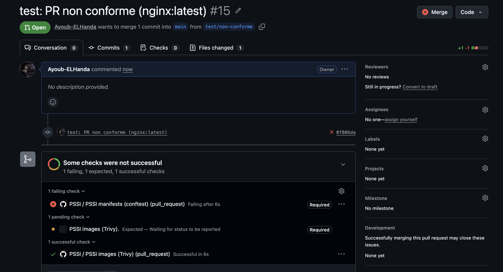
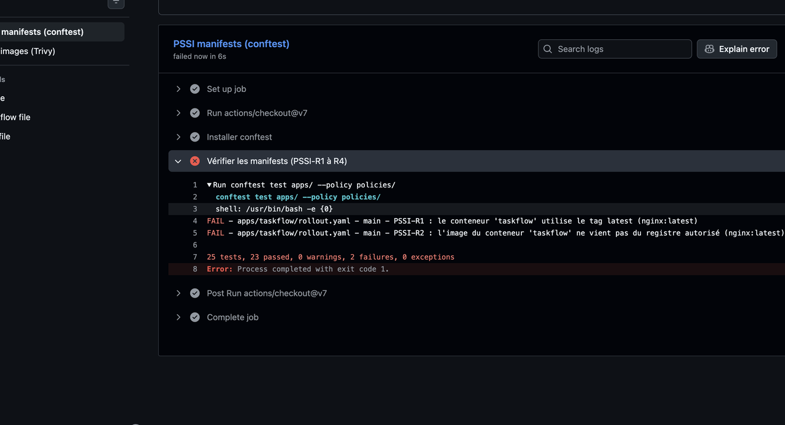
## Binôme
Ayoub EL-Handa, Ayoub EL-OMARY
